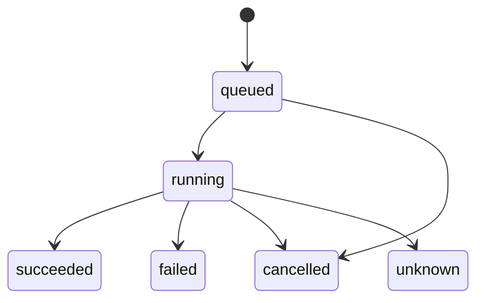

# Durable work

Some work changes something outside the database, such as a VM, a disk or a file. When the process
stops halfway, that work must finish or unwind after the restart. The durable work package gives a
program an event log that numbers each change, operations that resume or undo their steps after a
restart, and reconcilers that check the system on a timer and start operations. The package never
refers to an imp concept, such as an imp or a checkpoint: the program that uses it defines each kind
of operation, event and reconciler, and owns the SQLite database.

[The overview](./overview.md) places the package among the others, and gives the import rule that
keeps it free of imp code.

## One transaction for a change and its record

The package never opens a transaction of its own. A function that makes several writes, such as a
prune, takes only a transaction, so the type check fails a call on a plain connection. A function
that makes one write, such as an event append, also accepts a plain connection, so the program must
pass it the transaction of the change the event describes. The change and its event then commit
together, or neither commits. A program that commits a change in one transaction and its event in
another can lose the event in a crash, and a reader then never learns of the change.

## The event log

Each event gets a sequence number from SQLite's `AUTOINCREMENT`, which never reuses a number, even
after the rows above it are removed. A reader keeps the sequence number of the last event it saw and
asks for the events after it. A reader that disconnects therefore misses nothing that is still in
the table.

The package runs no timer, so the program calls the event prune itself. The prune keeps the events
younger than `EVENT_MAX_AGE_MS`, but at most the newest `EVENT_MAX_ROWS`, and saves the highest
sequence number it removed as the prune mark. When a reader asks for the events after a number below
the mark, it gets a reset in place of events, because some events it has not seen are gone. The
reset carries the prune mark. The reader then reads the current state from the program's own rows,
and asks for the events after the mark. Some of those events may already show in the state it read,
so a reader must apply an event twice with no harm.

The first migration gives each database a random log ID. A reader compares the log ID with the one
it saw before. A different ID shows that the database file was replaced, so the reader drops its
sequence number. A copy of the file keeps the log ID of the original. After a copy is restored over
the file, new events take numbers the reader has already seen, and the reader skips them. Whoever
restores a copy must therefore restart its readers from the current state.

## Operations

The program defines each kind of operation as steps that run in a fixed order, such as the steps of
a build. It starts an operation with params, a target and a principal: the target is the ID of the
thing the operation changes, and the principal is the ID of the caller that asked for it. The
operation runner runs the steps and writes the state of the operation and of each step, so a process
that starts after a crash reads which step was running.

Each step runs its effect outside the database. The runner then commits the step's success, any
change the step returns for the program's own rows, and its event, in one transaction. A crash
before that commit leaves the step's effect done or half done. A crash between two commits leaves
nothing in doubt. At startup the program calls the runner's recovery, which starts each operation
that had not ended, queued ones included. An operation that stopped between two commits goes on with
its next step. For a step that was running, the runner follows the restart rule of the step:

| Rule      | Use it for a step that…                                       | After a restart                                                                |
| --------- | ------------------------------------------------------------- | ------------------------------------------------------------------------------ |
| `rerun`   | gives the same result when it runs twice                      | the step runs again, and the operation goes on                                 |
| `fail`    | can't run twice, and writes an undo record before its effect  | the operation fails with the error code `interrupted`, and the undo runs       |
| `unknown` | has an effect nobody can check, such as a command inside a VM | the operation ends `unknown`; the runner never reruns the step or runs an undo |

An operation that ends `unknown` needs a check from outside the runner, such as a reconciler of the
program, to find what the step did.

A step may write an undo record before its effect, such as the name of the file it is about to
create. The undo then finds what to remove even when the process stopped halfway through the step.
The runner never undoes a step that stopped before it succeeded and wrote no undo record, so a
`fail` step whose undo must run after a restart writes its record first. The undo runs when a step
fails, when the operation is cancelled, or when a `fail` step was running at a restart. It runs for
each step that succeeded, for each step that wrote an undo record, and for each step whose effect
returned but whose success commit failed, the last step first. The runner marks each undo done in
its own commit, and a crash before that commit makes the undo run again after the restart, so an
undo must be safe to run twice. When an undo throws, the runner logs a warning and stops that run.
The operation stays open with its undos unfinished, so the next run, or the recovery at the next
start, tries the undo again. The operation ends only when every undo has run.

The runner saves a cancel request on the operation row first, so the request survives a restart. The
runner then aborts the signal it passed to the running step. When the step returns, the undo runs
and the operation ends `cancelled`. A queued operation ends `cancelled` with no step run.

The program may give an operation a retry key, so a caller that sends the same request twice gets
one operation. A request with a key that an operation holds returns that operation when the kind,
params, target and principal match, and a conflict when any of them differs. The package compares
the params in a canonical form, so the order of their keys makes no difference. A key stays taken
for `RETRY_KEY_KEEP_MS` after its operation ends. The program calls the operation prune, which
removes an operation `OPERATION_KEEP_MS` after it ends. The key expires first, so a retry never
meets a key whose operation is gone.

The package's wait function waits for an operation to change. The runner notifies a change signal
after each commit. The signal carries no data, so the wait function reads the operation again and
checks it. It subscribes to the next signal before it reads, so a commit that lands between its read
and its wait still wakes it. The signal fires only on the runner's commits. A program that waits on
its own rows must notify the signal after each commit to them.

## Reconcilers

A reconciler looks at the system on an interval, decides what should change, and returns an outcome
of `changed` or `unchanged` with a summary. The reconciler never changes a VM, a disk or a file
itself. Each pass gets a function from the reconciler runner that starts an operation, so the change
gets steps, a record and an undo.

The reconciler runner never runs two passes of one reconciler at the same time. Passes of different
reconcilers run independently. When the program calls the runner's trigger for a reconciler, a pass
runs now. A trigger that arrives during a pass runs one more pass after it, however many triggers
arrive. A pass that throws counts as an error. After n errors in a row, the next pass waits up to
the interval × 2ⁿ, and never more than 10 × the interval. The runner picks a random wait between
half and all of that limit, so reconcilers that fail together don't retry together.

The runner keeps the last result of each reconciler in memory, and returns it from the runner's
list. It writes the result to the `reconcilers` table only when the outcome differs from the saved
one, so a reconciler that runs several times a second and finds nothing to do writes nothing. A new
summary with the same outcome therefore stays in memory only. The runner reads the saved results
when it starts, so a restart doesn't write an outcome that is already saved. When it stops, the
runner aborts the signal of each running pass and waits for the pass to end.

## Where the state lives

The program adds the package's migrations to its own migrator. The migration names start with
`durable_`, so they never clash with the program's names.

| Table             | Owns                                                                    |
| ----------------- | ----------------------------------------------------------------------- |
| `events`          | one row per event, with its sequence number                             |
| `event_log`       | one row: the log ID and the prune mark                                  |
| `operations`      | one row per operation: its state, its params, its retry key and its end |
| `operation_steps` | one row per step: its state, its undo record and when it was undone     |
| `reconcilers`     | one row per reconciler: its last saved outcome and summary              |
