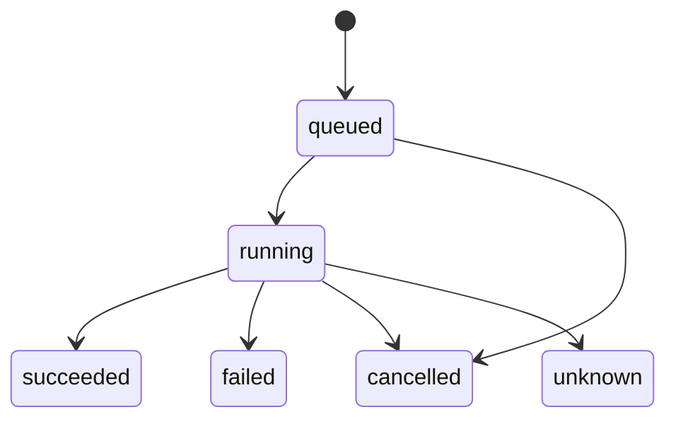

# Durable work

Some work changes something outside the database, such as a VM, a disk or a file. When the process
stops halfway, that work must finish or unwind after the restart. The durable work package gives a
program an event log that numbers each change, operations that resume or undo their steps after a
restart, and reconcilers that check the system on a timer and start operations. The package knows
nothing of impd, the daemon that uses it, or of impd's records, such as an imp (a VM) or a
checkpoint: the program that uses the package defines each kind of operation, event and reconciler,
and owns the SQLite database.

[The overview](./overview.md) places the package among the others, and gives the import rule that
keeps it free of imp code.

## One transaction for a change and its record

The package never opens a transaction of its own. A function that makes several writes, such as a
prune, takes only a transaction, so the type check fails a call on a plain connection. A function
that makes one write, such as an event append, also accepts a plain connection, so the type check
misses a call outside the transaction. The program must pass it the transaction of the change the
event describes. The change and its event then commit together, or neither commits. A program that
commits a change in one transaction and its event in another can lose the event in a crash, and a
reader then never learns of the change.

## The event log

Each event gets a sequence number from SQLite's `AUTOINCREMENT`, which never reuses a number, even
after the rows above it are removed. A reader keeps the sequence number of the last event it saw and
asks for the events after it. A reader that disconnects therefore misses nothing that is still in
the table.

The package runs no timer, so the program calls the event prune itself. The prune keeps the events
younger than `EVENT_MAX_AGE_MS`, but at most the newest `EVENT_MAX_ROWS`, and saves the highest
sequence number it removed as the prune mark. When a reader asks for the events after a number below
the mark, it gets a reset in place of events, because some events it has not seen are gone. The
reset carries the prune mark. The reader then reads the current state from the program's own rows,
and asks for the events after the mark. Some of those events may already show in the state it read,
so applying an event a second time must do a reader no harm.

The first migration gives each database a random log ID. A reader keeps the log ID beside its
sequence number, and drops the sequence number when the log ID it reads differs. The program gives
the log a new ID after a restore, and after another program's write to the tables its events
describe, so that its readers start again from the program's own rows.

A program copies its database file for a backup, such as impd's database copy, and an operator may
later restore that copy in place of the file. A plain copy keeps the log ID of the original, so the
restored file would give new events numbers a reader has already seen, and the reader would skip
those events. The program prevents this:

1. It calls `removeLogID` on each copy it makes, which clears the copy's log ID.
2. It calls `writeNewLogID` each time it opens the file, which gives a file with no log ID a new
   random one.

An operator who rolls the program back to an older release runs that release on the same file, and a
release from before the event log changes the tables with no event. A reader would never learn of
those changes. Each time the program opens the file, it calls these, in order:

1. `createOutsideWriteTriggers`, with the tables its events describe. It adds the
   `event_log_outside_writes` table and two kinds of trigger:
   - database triggers that put a mark row in that table on each insert, update or delete in the
     described tables;
   - a temporary trigger, on the program's own connection only, that runs before each insert of a
     mark row and skips that insert with `RAISE(IGNORE)`.
2. `removeLogIDAfterOutsideWrites`, which clears the log ID when a mark row exists, and removes the
   mark.
3. `writeNewLogID`.

The program's own writes leave no mark. Another release's connection has no temporary trigger, so
its writes leave one, and the program's next open gives the log a new ID. That release keeps the log
ID it reads while it runs, so a release that serves events itself serves a stable ID. A migration
that changes the described tables leaves a mark too, because the program's migrations run before
step 1 adds the temporary trigger, and they append no events. `createOutsideWriteTriggers` adds its
table and triggers without a migration, because an older release refuses a database with a migration
it does not know. impd passes `imps` and `checkpoints`.

## Operations

The program defines each kind of operation as steps that run in a fixed order, such as the steps of
a build. It starts an operation with params, a target and a principal: the target is the ID of the
thing the operation changes, and the principal is the ID of the caller that asked for it. The
operation runner runs the steps and writes the state of the operation and of each step, so a process
that starts after a crash reads which step was running.

Each step runs its effect outside the database. The runner then commits the step's success, any
change the step returns for the program's own rows, and its event, in one transaction. A crash
before that commit leaves the step's effect done or half done. A crash after one step's commit and
before the next step starts leaves nothing in doubt. At startup the program calls the runner's
`recover`, which resumes each operation that had not ended, queued ones included. An operation that
stopped after a step's commit goes on with its next step. For a step that was running, the runner
follows the restart rule of the step:

| Rule      | Use it for a step that…                                       | After a restart                                                                |
| --------- | ------------------------------------------------------------- | ------------------------------------------------------------------------------ |
| `rerun`   | gives the same result when it runs twice                      | the step runs again, and the operation goes on                                 |
| `fail`    | can't run twice                                               | the operation fails with the error code `interrupted`, and the undos run       |
| `unknown` | has an effect nobody can check, such as a command inside a VM | the operation ends `unknown`; the runner never reruns the step or runs an undo |

An operation that ends `unknown` needs a check from outside the runner, such as a reconciler of the
program, to find what the step did.

A step may write an undo record before its effect, such as the name of the file it is about to
create. The undo then finds what to remove even when the process stopped halfway through the step. A
step that stopped halfway with no undo record gets no undo. A `fail` step whose undo must run after
a restart therefore writes its record before its effect.

The runner runs the undos in these cases:

- a step fails;
- the operation is cancelled;
- a `fail` step was running at a restart.

It undoes these steps, the last step first:

- each step that succeeded;
- each step that wrote an undo record;
- each step whose effect finished but whose success the runner could not commit.

The runner marks each undo done in its own commit. A crash before that commit makes the undo run
again after the restart, so an undo must be safe to run twice. When an undo throws, the runner logs
a warning and returns, and the operation stays `running` with its undos unfinished. The program's
next call of the runner's `run` for that operation, or its `recover` at the next start, tries the
undo again. The operation ends `failed` or `cancelled` only when every undo has run.

The runner saves a cancel request on the operation row first, so the request survives a restart. The
runner then aborts the signal it passed to the running step. When the step returns, the undo runs
and the operation ends `cancelled`. A queued operation ends `cancelled` with no step run.

The program may give an operation a retry key, so a caller that sends the same request twice gets
one operation. When a request carries a key that an operation holds, the package returns that
operation if the kind, params, target and principal match, and a conflict if any of them differs.
The package compares the params in a canonical form, so the order of their keys makes no difference.
A key stays taken for `RETRY_KEY_KEEP_MS` after its operation ends. The program calls the operation
prune, which removes an operation `OPERATION_KEEP_MS` after it ends. The key expires first, so a
retry never meets a key whose operation is gone. No check keeps that order: keep `RETRY_KEY_KEEP_MS`
the shorter when you change either.

`waitForChange` waits for an operation to change. The runner calls `notify` on a change signal, from
`createChangeSignal`, after each commit. The signal carries no data, so `waitForChange` reads the
operation again and checks it. `waitForChange` subscribes to the next signal before it reads, so a
commit that lands between its read and its wait still wakes it. The runner notifies the signal only
on its own commits. A program that calls `waitForChange` to wait for its own rows must call `notify`
after each commit that changes those rows.

## Reconcilers

The program defines a reconciler to check the system on an interval. Each pass decides what should
change, and returns an outcome of `changed` or `unchanged` with a summary. The reconciler never
changes a VM, a disk or a file itself. Each pass gets a function from the reconciler runner that
starts an operation, so the change gets steps, a record and an undo.

The reconciler runner never runs two passes of one reconciler at the same time. Passes of different
reconcilers run independently. When the program calls the runner's `trigger` for a reconciler, a
pass runs now. A trigger that arrives during a pass runs one more pass after it, however many
triggers arrive. A pass that throws counts as an error. After n errors in a row, the next pass waits
up to the interval × 2ⁿ, and never more than 10 × the interval. The runner picks a random wait
between half and all of that limit, so reconcilers that fail together don't retry together.

The runner keeps the last result of each reconciler in memory, and returns it from its `list`
method. It writes the result to the `reconcilers` table only when the outcome differs from the saved
one, so a reconciler that runs several times a second and finds nothing to do writes nothing. A new
summary with the same outcome therefore stays in memory only. The runner reads the saved results
when it starts, so a restart doesn't write an outcome that is already saved. When it stops, the
runner aborts the signal of each running pass and waits for the pass to end.

## Where the state lives

The program adds the package's migrations to its own migrator. The migration names start with
`durable_`, so they never clash with the program's names.

| Table                      | Owns                                                                    |
| -------------------------- | ----------------------------------------------------------------------- |
| `events`                   | one row per event, with its sequence number                             |
| `event_log`                | one row: the log ID and the prune mark                                  |
| `event_log_outside_writes` | one row, or none: the mark of another program's write                   |
| `operations`               | one row per operation: its state, its params, its retry key and its end |
| `operation_steps`          | one row per step: its state, its undo record and when it was undone     |
| `reconcilers`              | one row per reconciler: its last saved outcome and summary              |
